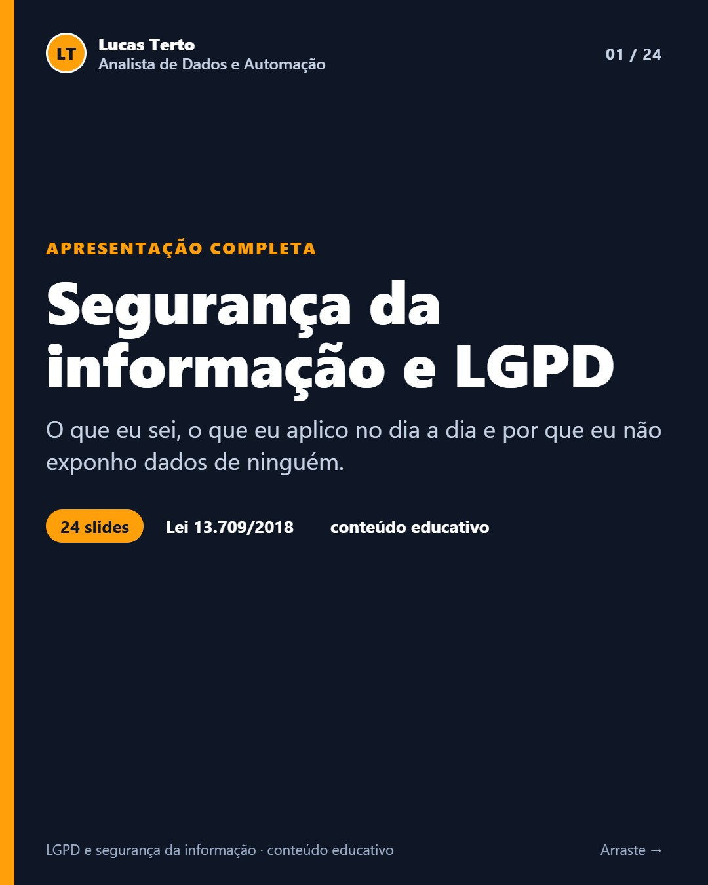
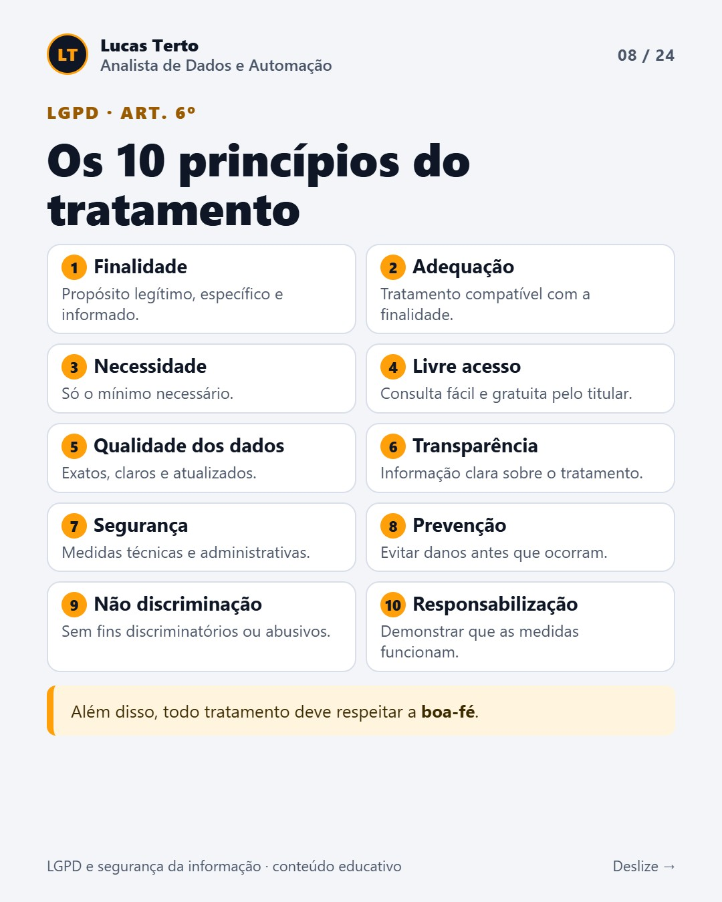
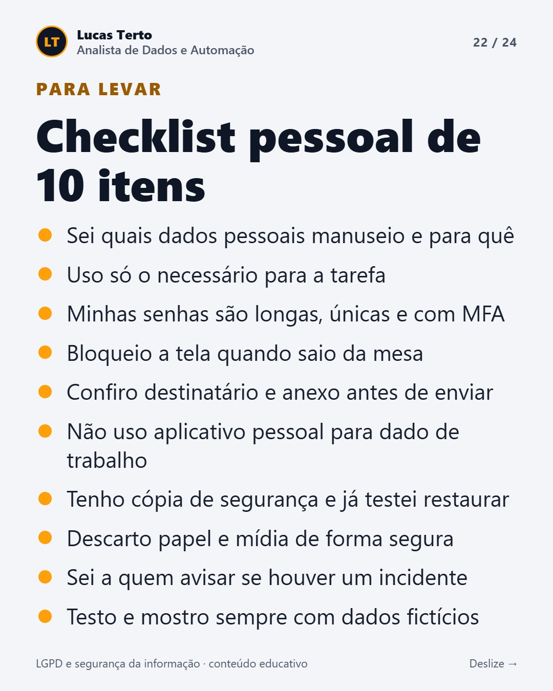
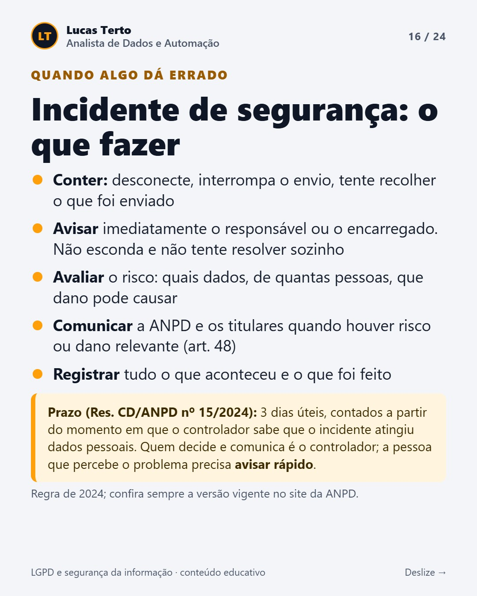

# LGPD e segurança da informação

Material educativo sobre a **Lei Geral de Proteção de Dados (Lei nº 13.709/2018)** e a segurança da informação na rotina administrativa. Inclui uma apresentação de 24 slides, um resumo em texto e um checklist prático.

> **Conteúdo educativo, não é parecer jurídico.** Não sou advogado. Para casos concretos, procure o encarregado de dados da sua organização ou um especialista em direito digital.

  
  
  

## Por que este repositório existe

Quem trabalha com rotina administrativa lida o tempo todo com dados de pessoas: nome, CPF, endereço, salário e atestado. Este material reúne o que eu estudei e o que aplico nos meus projetos de automação para proteger esses dados.

Ele acompanha a minha publicação no LinkedIn de 22/10/2026.

## O que tem aqui

| Arquivo | O que é |
|---|---|
| [docs/resumo.md](docs/resumo.md) | O conteúdo dos 24 slides em texto, com os artigos da lei |
| [docs/checklist.md](docs/checklist.md) | O checklist pessoal e as boas práticas da rotina, para copiar e usar |
| [docs/fontes.md](docs/fontes.md) | As fontes consultadas e o que foi conferido |
| [Releases](https://github.com/TTV98/lgpd-e-seguranca-da-informacao/releases) | A apresentação completa em PDF (24 slides) |

## Conteúdo da apresentação

1. Conceitos: segurança da informação × LGPD e os três pilares (confidencialidade, integridade e disponibilidade)
2. Vocabulário da lei e a diferença entre dado pessoal e dado pessoal sensível (art. 5º)
3. Os 10 princípios (art. 6º), as 10 bases legais (art. 7º) e os direitos do titular (art. 18)
4. Agentes de tratamento e encarregado (arts. 41 e 42)
5. Ciclo de vida do dado (arts. 15 e 16)
6. Segurança na prática: pessoas, técnica e rotina administrativa
7. Incidente de segurança: o que fazer (art. 48 e Resolução CD/ANPD nº 15/2024)
8. Sanções (art. 52) e governança (arts. 37, 38 e 50)
9. Como eu aplico isso nos meus projetos e o que eu não faço
10. Mitos e verdades, checklist e fontes

  

## O que foi conferido e o que não foi

**Conferido em 27/10/2026** no texto da lei do site do Planalto:
- os artigos 5º (II), 6º, 7º, 11, 15, 16, 18, 19, 37, 38, 41, 42, 46, 48, 50 e 52 batem com o que está nos slides;
- a contagem: são 10 princípios, 10 bases legais e 9 direitos do titular;
- a multa simples é de até 2% do faturamento no Brasil, limitada a R$ 50 milhões por infração, e o prazo da declaração completa é de até 15 dias.

**Não conferido no texto oficial:**
- a data de início das sanções (1º/8/2021, art. 65): a conferência foi feita por um resumo da página, e não pelo trecho original;
- a menção a regras diferenciadas para agentes de pequeno porte (art. 55-J): também conferida só por um resumo;
- os prazos da Resolução CD/ANPD nº 15/2024: vieram de resumos de terceiros. Confira o texto vigente no site da ANPD.

**Atualização:** o texto da lei no Planalto mostra uma alteração recente (Lei nº 15.352/2026) que muda o nome da ANPD para **Agência** Nacional de Proteção de Dados. A apresentação, feita antes, usa "Autoridade". Não conferi a lei nova no Diário Oficial.

Leis e resoluções mudam. Se for usar este material como base para uma decisão, confira sempre a versão vigente nas fontes oficiais.

## Ferramentas usadas

- Os slides foram gerados em HTML e convertidos em PDF com a biblioteca [pdf-lib](https://github.com/Hopding/pdf-lib) (licença MIT).
- O código do gerador não está neste repositório, porque faz parte de outro projeto.
- Usei IA como apoio ([Claude Code](https://claude.com/claude-code)): eu defini o conteúdo e as regras, conferi e revisei.

## Licença

Textos, imagens e PDF sob [CC BY 4.0](LICENSE.md): você pode usar e adaptar o material, desde que cite a fonte. O texto da lei é de domínio público.

## Autor

**Lucas Terto**: [LinkedIn](https://www.linkedin.com/in/soulucas1212) · [outros repositórios](https://github.com/TTV98)
